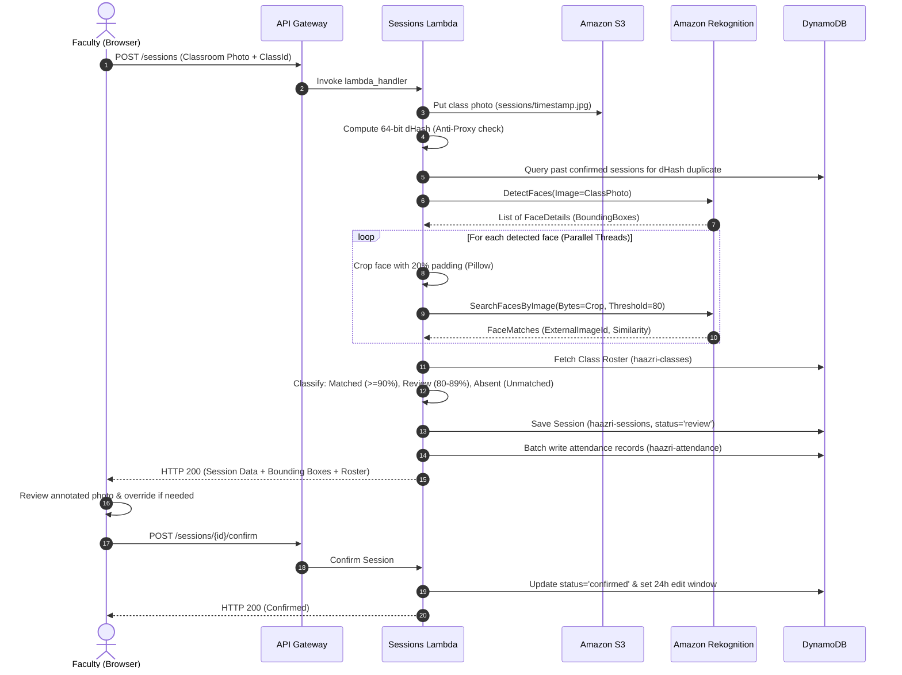

# Haazri Architecture & Web Services Integration Guide

This document explains the end-to-end architecture of **Haazri**, detailing how the **Storage Service (Amazon S3)**, **Database (Amazon DynamoDB)**, and **Biometric Tool (Amazon Rekognition)** are connected, along with the detailed functioning of each serverless web service component.

---

## 1. High-Level Architecture Overview

Haazri is built entirely on a serverless, event-driven, pay-per-use architecture on AWS. It eliminates idle server costs while scaling automatically with campus lecture loads.

```mermaid
flowchart TD
    subgraph Client["Client Tier (React + Vite + TailwindCSS)"]
        UI["Web Browser (Faculty / Admin / Student)"]
    end

    subgraph Auth["Authentication Tier"]
        COG["Amazon Cognito User Pool\nGroups: admin, teacher, student"]
    end

    subgraph API["API Gateway Tier"]
        APIGW["HTTP API Gateway (v2)\nCORS & JWT Authorization"]
    end

    subgraph Compute["Serverless Compute Tier (AWS Lambda - Python 3.12)"]
        LF_AUTH["AuthFunction (/me)"]
        LF_STU["StudentsFunction (/students)"]
        LF_CLS["ClassesFunction (/classes)"]
        LF_SESS["SessionsFunction (/sessions)\n+ Pillow Layer (x86_64)"]
        LF_ANL["AnalyticsFunction (/analytics)"]
        LF_SET["SettingsFunction (/settings, /audit)"]
        LF_ALT["AlertsFunction (Cron / EventBridge)"]
    end

    subgraph Storage["Storage Tier"]
        S3["Amazon S3 Photos Bucket\n(haazri-photos-*)"]
    end

    subgraph Biometrics["Biometrics Tier"]
        REK["Amazon Rekognition\nCollection: haazri-faces"]
    end

    subgraph Database["Database Tier (Amazon DynamoDB)"]
        DDB_STU[("haazri-students")]
        DDB_CLS[("haazri-classes")]
        DDB_SES[("haazri-sessions")]
        DDB_ATT[("haazri-attendance")]
        DDB_AUD[("haazri-audit")]
        DDB_SET[("haazri-settings")]
    end

    subgraph Notification["Notification Tier"]
        SES["Amazon SES (Email Alerts)"]
    end

    UI -->|1. Authenticate| COG
    COG -->|JWT Token| UI
    UI -->|2. REST Requests + Bearer Token| APIGW
    APIGW --> LF_AUTH & LF_STU & LF_CLS & LF_SESS & LF_ANL & LF_SET

    LF_STU -->|Presigned PUT URL / Store Face| S3
    LF_STU -->|IndexFaces / DetectFaces| REK
    LF_STU -->|CRUD Student Profiles| DDB_STU

    LF_CLS -->|CRUD Classes & Rosters| DDB_CLS

    LF_SESS -->|Download Class Photo| S3
    LF_SESS -->|1. DetectFaces (All)| REK
    LF_SESS -->|2. Crop with Pillow| LF_SESS
    LF_SESS -->|3. SearchFacesByImage (Per Crop)| REK
    LF_SESS -->|Write Session & Stats| DDB_SES
    LF_SESS -->|Write Individual Records| DDB_ATT
    LF_SESS -->|Log Overrides| DDB_AUD

    LF_ANL -->|Scan & Aggregate Metrics| DDB_SES & DDB_ATT & DDB_STU & DDB_CLS
    LF_SET -->|Read / Update Config| DDB_SET

    LF_ALT -->|Read Defaulters| DDB_ATT & DDB_STU
    LF_ALT -->|Dispatch Warnings| SES
```

---

## 2. Connecting S3, DynamoDB, and Amazon Rekognition

The core innovation of Haazri is the automated synchronization between **unstructured photo storage (S3)**, **vectorized facial embeddings (Rekognition)**, and **structured relational attendance records (DynamoDB)**.

### A. Storage Service (Amazon S3)

**Bucket**: `haazri-photos-${AWS::AccountId}-${AWS::Region}`

1. **Security & Privacy**:
   - **Public Access Block**: All public ACLs and bucket policies are blocked. Student photos are never publicly accessible via direct URLs.
   - **Default Encryption**: Server-side encryption with AWS managed keys (`AES256`).
   - **Lifecycle Rule**: S3 objects automatically expire and delete after 30 days (`ExpirationInDays: 30`) to comply with privacy regulations and avoid accumulation costs.
   - **CORS Configuration**: Configured to allow `PUT`, `GET`, `POST` with `Authorization` headers from `http://localhost:3000` and `http://localhost:5173`.
2. **Dual-Ingestion Pipeline**:
   - **Direct S3 Presigned Uploads**: The frontend calls `POST /sessions/presign` or `POST /students/{id}/photos/presign`. Lambda generates an S3 presigned PUT URL with a 5-minute expiration window (`ExpiresIn=300`). The client uploads directly from browser to S3 without passing binary blobs through API Gateway.
   - **Base64 DataURL Ingestion**: For webcam captures or quick preset testing, the frontend sends base64 DataURLs (`data:image/jpeg;base64,...`). The Lambda decodes the payload, generates a timestamped key (`sessions/{timestamp}_{idx}.jpg`), and puts the object into S3 via `boto3.client('s3').put_object`.

---

### B. Face Recognition Service (Amazon Rekognition)

**Collection ID**: `haazri-faces`

Amazon Rekognition is used in three distinct stages:

#### 1. Student Enrollment (`IndexFaces`)
When a student is registered:
- Quality verification is performed via `DetectFaces`:
  - `Brightness >= 30` and `Sharpness >= 30`.
  - Must contain exactly 1 frontal face (`Pose.Yaw` and `Pose.Pitch` within $\pm 30^\circ$).
- `IndexFaces` is called with:
  - `CollectionId`: `haazri-faces`
  - `ExternalImageId`: The student's institutional roll number (e.g., `TE-A-01`).
  - `DetectionAttributes`: `['DEFAULT']`.
- Rekognition generates a high-dimensional mathematical facial vector, indexes it in the collection, and returns a unique `FaceId` (UUID). The raw photo is stored in S3, while the `FaceId` and `ExternalImageId` are linked in DynamoDB.

#### 2. Classroom Face Detection (`DetectFaces`)
When a wide-angle lecture hall photo is submitted:
- Lambda invokes `rekognition.detect_faces(Image={'Bytes': img_bytes}, Attributes=['DEFAULT'])`.
- Rekognition returns bounding box coordinates (`Top`, `Left`, `Width`, `Height` normalized from 0.0 to 1.0) for every visible person in the classroom (up to 100 faces per image).

#### 3. Face Cropping & Vector Search (`SearchFacesByImage`)
> [!IMPORTANT]
> Amazon Rekognition's `SearchFacesByImage` API only searches for the **largest** face in an image. If passed an entire classroom photo, it would match only one student and ignore the remaining 40 to 60 students.

To overcome this constraint, Haazri implements an in-memory cropping pipeline:
1. **Lambda Pillow Layer**: The Lambda runtime includes a compiled `Pillow 12.2.0` layer (`manylinux2023_x86_64`).
2. **Padding Extraction**: For each detected bounding box, Lambda crops the face with **20% outer padding** (`pad_w = box_width * 0.20`, `pad_h = box_height * 0.20`) to preserve forehead, chin, and ear contours.
3. **Parallel Vector Matching**: Using Python's `concurrent.futures.ThreadPoolExecutor(max_workers=8)`, Lambda concurrently dispatches `rekognition.search_faces_by_image` for each cropped face:
   ```python
   resp = rekognition.search_faces_by_image(
       CollectionId='haazri-faces',
       Image={'Bytes': cropped_face_bytes},
       FaceMatchThreshold=80.0,
       MaxFaces=1
   )
   ```
4. **Classification**:
   - $\text{Confidence} \ge 90\%$: Classified as **Matched** (`status: 'matched'`).
   - $80\% \le \text{Confidence} < 90\%$: Classified as **Review Band** (`status: 'review'`).
   - $\text{Confidence} < 80\%$ or no vector match: Classified as **Unknown** (`status: 'unknown'`).

#### 4. Anti-Proxy Perceptual dHash Check
To prevent recycled photos (students using yesterday's attendance photo):
- Lambda computes a 64-bit difference hash (**dHash**):
  - Converts image to grayscale (`L`).
  - Resizes to $9 \times 8$ pixels.
  - Compares adjacent horizontal pixels ($P[x] > P[x+1]$) to generate a 16-character hex string.
- Scans `haazri-sessions` to verify if this hash already exists for any confirmed session. If detected, the session is rejected with an `Anti-Proxy Alert`.

---

### C. Database Service (Amazon DynamoDB)

Haazri uses 6 purpose-built DynamoDB tables configured with single-digit millisecond latency:

| Table Name | Partition Key (PK) | Sort Key (SK) | Global Secondary Indexes (GSI) | Purpose |
| :--- | :--- | :--- | :--- | :--- |
| **`haazri-students`** | `studentId` (String) | — | — | Student profiles, division, year, enrolled `faceIds[]`, consent timestamp, S3 photo keys. |
| **`haazri-classes`** | `classId` (String) | — | `TeacherIndex` (`teacherId`) | Academic classes, subject title, division, assigned faculty ID, enrolled `studentIds[]`. |
| **`haazri-sessions`** | `classId` (String) | `dateSlot` (String, e.g. `2026-10-22#11:15 - 12:15 PM`) | `SessionIdIndex` (`sessionId`) | Lecture sessions, summary stats, bounding boxes, photo keys, dHash array, session status (`review`, `confirmed`). |
| **`haazri-attendance`** | `sessionId` (String) | `studentId` (String) | `StudentHistoryIndex` (`studentId`, `date`) | Individual student attendance records, status (`present`, `absent`, `manual`), confidence, audit reasons. |
| **`haazri-audit`** | `auditId` (String) | — | `SessionAuditIndex` (`sessionId`) | Immutable audit trail for manual attendance overrides, policy threshold changes, face deletions. |
| **`haazri-settings`** | `id` (String: `'global'`) | — | — | Campus-wide settings: match threshold ($90\%$), review threshold ($80\%$), shortage cutoff ($75\%$), 24-hr edit window. |

#### Boto3 Serialization (`to_dynamo`)
Because Amazon Rekognition outputs floating-point coordinates and confidences (e.g. `99.8421`), and Python's `boto3` DynamoDB resource strictly forbids native `float` types, Haazri implements a recursive serializer:
```python
def to_dynamo(val):
    if isinstance(val, float):
        return Decimal(str(round(val, 4)))
    elif isinstance(val, dict):
        return {k: to_dynamo(v) for k, v in val.items()}
    elif isinstance(val, list):
        return [to_dynamo(v) for v in val]
    return val
```

---

## 3. Functioning of Each Serverless Web Service Component

```
┌────────────────────────────────────────────────────────────────────────────────────────┐
│                                HTTP API GATEWAY (v2)                                   │
└──────────┬─────────────┬─────────────┬─────────────┬─────────────┬─────────────┬───────┘
           │             │             │             │             │             │
           ▼             ▼             ▼             ▼             ▼             ▼
     ┌───────────┐ ┌───────────┐ ┌───────────┐ ┌───────────┐ ┌───────────┐ ┌───────────┐
     │   Auth    │ │ Students  │ │  Classes  │ │ Sessions  │ │ Analytics │ │ Settings  │
     │ Function  │ │ Function  │ │ Function  │ │ Function  │ │ Function  │ │ Function  │
     └───────────┘ └───────────┘ └───────────┘ └───────────┘ └───────────┘ └───────────┘
```

### 1. `AuthFunction`
- **Route**: `GET /me`
- **Responsibility**: 
  - Validates the incoming Cognito Bearer JWT token from the `Authorization` header.
  - Resolves identity claims (`sub`, `email`, `cognito:groups`, `name`).
  - Matches the user's role (`admin`, `teacher`, `student`) and returns their profile and linked IDs to authorize frontend route guards.

### 2. `StudentsFunction`
- **Routes**: `GET /students`, `POST /students`, `PUT /students/{id}`, `DELETE /students/{id}`, `POST /students/{id}/enroll`, `DELETE /students/{id}/faces`, `POST /students/import`, `GET /students/{id}/portal`.
- **Responsibility**:
  - Manages student directories across academic divisions (`TE-A`, `TE-B`, `TE-C`).
  - Orchestrates facial enrollment: takes photos, verifies image quality, calls `IndexFaces`, and links the returned `FaceId` to the student's profile.
  - Supports CSV bulk import with automatic batch creation in DynamoDB.
  - Powers the **Student Self-Service Portal**, allowing students to view their attendance percentages, shortage alerts, and lecture histories.

### 3. `ClassesFunction`
- **Routes**: `GET /classes`, `POST /classes`, `GET /classes/{id}`, `PUT /classes/{id}`.
- **Responsibility**:
  - Maintains institutional academic class rosters.
  - Maps subjects (e.g., *Database Systems*, *Cloud Computing*) to assigned faculty user IDs.
  - Tracks student enrollment lists (`studentIds[]`) and cumulative session counts.

### 4. `SessionsFunction` (Core Biometric Pipeline)
- **Routes**: `GET /sessions`, `POST /sessions`, `GET /sessions/{id}`, `POST /sessions/{id}/confirm`, `PATCH /sessions/{id}/attendance/{studentId}`, `POST /sessions/{id}/assign-face`.
- **Responsibility**:
  - Accepts classroom photos either via presigned S3 URLs or direct Base64 DataURLs.
  - Computes `dHash` and executes anti-proxy duplicate photo verification.
  - Executes `DetectFaces`, crops faces using Pillow in memory, and coordinates multi-threaded `SearchFacesByImage` against `haazri-faces`.
  - Matches detected faces against the specific class roster: students matched with $\ge 90\%$ confidence are marked `present`, while missing roster students are marked `absent`.
  - Powers the **Annotated Canvas UI** with normalized bounding boxes, confidence tags, and synchronized roster navigation.
  - Handles **Manual Overrides** with mandatory audit reason logging (`haazri-audit`).
  - Handles **Session Confirmation**: locks the session, starts the 24-hour faculty edit window, and updates class attendance counters.

### 5. `AnalyticsFunction`
- **Routes**: `GET /analytics/overview`, `GET /analytics/trend`, `GET /analytics/status-split`, `GET /analytics/subjects`, `GET /analytics/heatmap`, `GET /analytics/defaulters`, `GET /analytics/confidence`.
- **Responsibility**:
  - Queries DynamoDB tables directly to aggregate campus-wide analytics in real time without external OLAP overhead.
  - Computes overall attendance percentage, enrollment completion rate, and defaulter lists ($< 75\%$).
  - Powers administrative and faculty charts: 30-day attendance trends, subject-wise comparisons, confidence score distributions, and time-slot heatmaps.

### 6. `SettingsFunction`
- **Routes**: `GET /settings`, `PUT /settings`, `GET /audit`, `GET /notifications`.
- **Responsibility**:
  - Stores institutional configuration (statutory attendance cutoff, match/review thresholds, photo retention window).
  - Retrieves paginated audit logs detailing every faculty override, threshold change, and student enrollment action.

### 7. `AlertsFunction` (Scheduled Background Cron)
- **Trigger**: AWS EventBridge Rule (`cron(0 14 * * ? *)` — daily at 7:30 PM IST).
- **Responsibility**:
  - Scans `haazri-attendance` and calculates aggregate percentage per student.
  - Identifies students below the statutory cutoff ($75\%$).
  - Formats warning notices and calls Amazon SES (`ses.send_email`) to alert students and parents.

---

## 4. End-to-End Data Flow (Taking Attendance)



---

## 5. Security & Principle of Least Privilege

1. **Authentication**: All client requests carry a Cognito JWT token containing the verified email, user group, and sub ID.
2. **API Isolation**: API Gateway validates the JWT token before routing.
3. **IAM Scoping**:
   - Lambda functions do not use wildcard administrative permissions.
   - S3 permissions are scoped to `haazri-photos-*`.
   - Rekognition permissions are restricted to `DetectFaces` and `SearchFacesByImage`.
   - DynamoDB access uses SAM policy templates (`DynamoDBCrudPolicy`, `DynamoDBReadPolicy`) scoped to individual table ARNs.
4. **Environment Isolation**:
   - Database table names, S3 bucket names, and collection IDs are injected via Lambda environment variables. No secrets or credentials are hardcoded.
