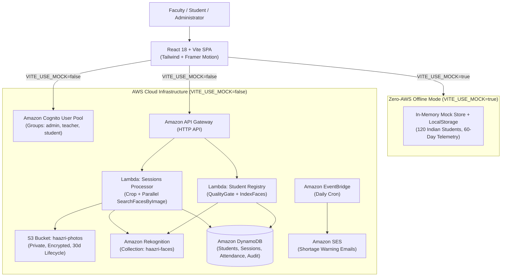

# हाज़िरी (Haazri) — Cloud Face Attendance System

[](frontend/src/tests/attendance.test.ts)
[](LICENSE)
[](https://aws.amazon.com)

**Haazri** (from the Hindi/Urdu word for attendance) is a modern, cloud-native facial recognition attendance management platform tailored for Indian engineering colleges and universities.

It eliminates 10+ minutes of manual roll-call per lecture and prevents proxy attendance. A teacher takes 1 or 2 classroom photos; **AWS Rekognition** detects and matches up to 60+ faces against enrolled students in seconds, flags ambiguous detections for faculty review, and stores immutable records in **Amazon DynamoDB**.

---

## 🏛️ System Architecture



---

## ✨ Key Features

- **⚡ 15-Second Lecture Marking**: Marks an entire hall of students from 1–3 classroom photos.
- **🎯 3-Tier Match Precision**:
  - `Confidence >= 90%`: Auto-matched and marked present (Deep Teal).
  - `80% <= Confidence < 90%`: Flagged for one-click teacher review (Marigold).
  - `Confidence < 80%`: Highlighted as unrecognized face (Brick Red) with one-click roster assignment.
- **🛡️ Anti-Proxy dHash Verification**: Computes an 8x8 perceptual difference hash (`dHash`) to reject recycled or duplicate photos.
- **🗂️ 1-Click Biometric Enrollment Studio**: Webcam guide oval with real-time pose/lighting hints and Indian DPDP Act 2023 biometric consent modal.
- **📊 7 Animated Analytical Charts**:
  1. **Daily Attendance Trend**: 30-day interactive area chart with subject filter.
  2. **Verification Split Donut**: Face AI vs. Absent vs. Manual override split.
  3. **Division Comparison Bar Chart**: Side-by-side performance across TE-A, TE-B, and TE-C.
  4. **Campus Heatmap**: 60-day calendar intensity matrix.
  5. **Progress Rings**: Subject attendance radial gauges with statutory 75% minimum marker.
  6. **Confidence Histogram**: Rekognition similarity score distribution.
  7. **Top 10 Defaulters Ranked List**: Instant visibility into chronic absentees.
- **🧮 "Bunk Calculator" (Student Portal)**: Dynamic calculator informing students exactly how many classes they can safely skip (or must attend) to stay above 75%.
- **📜 Certified Exports**: Export audit-compliant records to CSV and print-ready PDF reports with college letterhead.
- **🎨 Warm Indian-Campus Editorial Design**: Hand-designed aesthetic featuring Fraunces serif typography, DM Sans, JetBrains Mono, hairline borders, and full Dark Mode toggle.

---

## 🚀 Quickstart: Running in Mock Mode (Zero AWS Required)

Mock Mode ships with **120 Indian students** across divisions `TE-A`, `TE-B`, and `TE-C`, 6 academic subjects, 3 faculty members, and **60 days of historical attendance telemetry**.

```bash
# 1. Clone repository & install dependencies
git clone https://github.com/your-org/haazri.git
cd haazri/frontend
npm install

# 2. Run local development server
npm run dev
```

Open your browser at `http://localhost:3000`.

### 🔑 Demo Accounts (1-Click Switcher Available on Sign-In)

| Role | Name | Email | Password |
| :--- | :--- | :--- | :--- |
| **Admin** | Dr. Hemant Bhargava (Exam Cell) | `admin@haazri.edu` | `password123` |
| **Teacher** | Prof. Sunita Kulkarni (Cloud Computing) | `sunita.k@engg.edu` | `password123` |
| **Student** | Aarav Sharma (TE-A-01) | `aarav.sharma@engg.edu` | `password123` |

*Tip: In Mock Mode, use the quick role switcher in the top navigation bar to toggle between Admin, Teacher, and Student views instantly.*

---

## ☁️ Live Mode: Deploying to AWS

### Prerequisites
- [AWS CLI](https://aws.amazon.com/cli/) configured with administrator credentials.
- [AWS SAM CLI](https://docs.aws.amazon.com/serverless-application-model/latest/developerguide/install-sam-cli.html) installed.
- Python 3.12 and Node.js 18+.

### 1. Deploy Cloud Backend (API Gateway, Cognito, Lambda, DynamoDB, S3)
```bash
cd infra
sam build
sam deploy --guided
```

Note down the `HttpApiUrl`, `CognitoUserPoolId`, and `PhotosBucketName` output values.

### 2. Configure Frontend Environment
In `frontend/.env`:
```env
VITE_USE_MOCK=false
VITE_AWS_REGION=ap-south-1
VITE_API_BASE_URL=https://<your-api-id>.execute-api.ap-south-1.amazonaws.com
VITE_COGNITO_USER_POOL_ID=<your-cognito-pool-id>
VITE_COGNITO_CLIENT_ID=<your-cognito-client-id>
VITE_S3_PHOTO_BUCKET=haazri-photos-<account-id>-ap-south-1
VITE_REKOGNITION_COLLECTION_ID=haazri-faces
```

### 3. Build & Deploy Frontend to S3 / CloudFront
```bash
cd frontend
npm run build

# Sync built assets to static hosting bucket
aws s3 sync dist/ s3://haazri-web-<account-id>-<region>/ --delete
```

### 4. Seed Live DynamoDB Database
```bash
python scripts/seed.py --region ap-south-1
```

---

## 🧪 Automated Testing

Run the test suite verifying face match classification, anti-proxy duplicate hashing, 75% attendance calculations, and role-based access security:

```bash
cd frontend
npm run test
```

Result:
```
✓ src/tests/attendance.test.ts (11 tests passed)
```

---

## 💰 Cost Breakdown (500 Students, 6 Lectures/Day)

| Component | Free Tier Coverage | Monthly Cost Estimate |
| :--- | :--- | :--- |
| **AWS Rekognition** | 5,000 free API searches/month | ~$0.28 |
| **AWS Lambda** | 1,000,000 free requests/month | $0.00 |
| **Amazon DynamoDB** | 25 GB storage free tier | $0.00 |
| **Amazon S3** | 5 GB free (with 30d auto-purge) | $0.00 |
| **Amazon Cognito** | 50,000 MAUs free | $0.00 |
| **Amazon SES** | 62,000 emails/month free | $0.00 |
| **Total** | | **< $0.50 / month** |

---

## ⚖️ Privacy & Regulatory Compliance (DPDP Act 2023)

- **Vector Privacy**: Only non-invertible facial embeddings are stored in Rekognition; raw photos expire automatically after 30 days via S3 lifecycle policies.
- **Biometric Consent**: Students explicitly accept informed consent prior to facial indexing.
- **Right to Erasure**: Students can submit vector deletion requests directly in the Student Portal, triggering immediate `DeleteFaces` purging.

---

## 📄 License
MIT © 2026 Haazri Team. Developed for collegiate computer vision and cloud infrastructure education.
