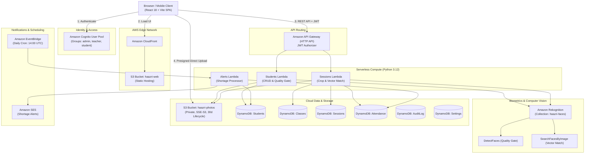

# Haazri Technical Architecture Document

## 1. System Overview

**Haazri** is an enterprise-grade, cloud-native face attendance system designed for higher education institutions. The system eliminates manual roll-call overhead and proxy attendance by automating classroom recognition through AWS Rekognition, Lambda (Python 3.12), DynamoDB, S3, and Amazon Cognito.

## 2. Architecture Diagram (Mermaid)

## 3. Core Processing Pipeline (Sessions Lambda)

1. **Presigned Upload**: Client requests a presigned PUT URL and uploads the high-resolution classroom photo directly to private S3 bucket `haazri-photos`.
2. **Duplicate Perceptual Hash (Anti-Proxy Check)**: Lambda computes an 8x8 difference hash (`dHash`). If identical to a hash from a previous session, the request is rejected immediately to prevent recycled photo fraud.
3. **Multi-Face Detection**: `DetectFaces` detects up to 100 face bounding boxes in the photo.
4. **Padding & Cropping**: Because `SearchFacesByImage` searches only the largest face, Pillow crops each detected face with **20% outer padding** to preserve jawline, ears, and hair contours.
5. **Parallel Vector Matching**: A `ThreadPoolExecutor` queries `SearchFacesByImage` concurrently for all cropped faces against collection `haazri-faces` with `FaceMatchThreshold=80.0`.
6. **Class-Roster Filtering**: Matches are correlated against the enrolled roster of the specific class; non-roster matches are logged but not marked present.
7. **Three-Tier Classification**:
   - `Confidence >= 90%`: **Matched (Verified Present)**
   - `80% <= Confidence < 90%`: **Needs Review (Low Confidence Flag)**
   - `Confidence < 80%` or Unindexed: **Unknown Face**
8. **Storage**: Session record is written to DynamoDB with status `review`. Normalized bounding box coordinates (0 to 1) are returned to the frontend.

## 4. Cost Guardrails & Free-Tier Estimates

Calculated for a representative college department: **500 students, 6 lecture sessions per day, 22 academic days per month (~132 sessions/month)**:

| AWS Service | Monthly Usage | Free Tier Allowance | Estimated Monthly Cost |
| :--- | :--- | :--- | :--- |
| **Amazon Rekognition** | ~132 sessions × 40 faces = 5,280 face searches | 5,000 free API calls/month (1st year) | **$0.00 – $0.28** |
| **AWS Lambda** | ~2,500 invocations, 1024 MB × 12s | 1,000,000 free requests + 400,000 GB-s | **$0.00** |
| **Amazon DynamoDB** | On-demand read/write (~20,000 ops) | 25 GB storage + generous free tier | **$0.00** |
| **Amazon S3** | ~200 photos/month (~150 MB storage) | 5 GB standard storage free | **$0.00** |
| **Amazon Cognito** | 500 MAUs (students + faculty) | 50,000 MAUs free | **$0.00** |
| **Amazon SES** | ~200 shortage alerts/month | 62,000 emails/month free from EC2/Lambda | **$0.00** |
| **Total Estimated Cost** | — | — | **< $0.50 / month** |

## 5. Security & DPDP Act 2023 Compliance

- **Biometric Vector Storage**: Raw facial images are stored in a private S3 bucket with strict lifecycle rules (default: auto-purged after 30 days). Rekognition stores only non-invertible vector embeddings.
- **Explicit Consent**: Section 6 of the Indian DPDP Act requires verifiable consent before indexing biometric markers. Students must accept the consent modal before face templates are indexed.
- **Right to Erasure**: Students can request biometric deletion through the self-service student portal, which triggers `DeleteFaces` and deletes S3 photos.
